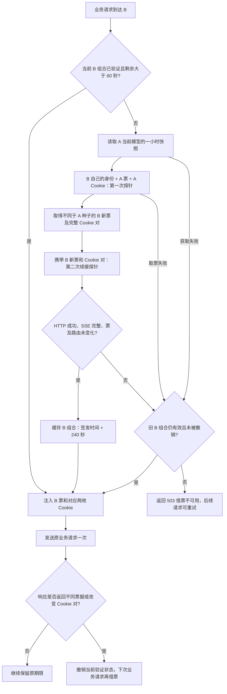

# 跨实例 SSE 借票：第一阶段实现与测试

本功能已合并到 `codex/oailb-borrow`，覆盖该分支的旧借票实现。实现最初在
`codex/sse-ticket-borrow` 开发，基于 CPA 主线 `e50b3414`。旧分支历史作为合并父提交保留。
实现参考 `ranxi2001/sub2api` 的借种子票、两次探针验证及路由 Cookie 配对方法；参考代码为
`production` 提交 `0d1f0359`（相关借票代码与 `v2.10.7` 一致）。
跨实例配置和管理密钥加密沿用 CPA `codex/oailb-borrow` 的方案。

本次只需要升级 **CLIProxyAPI**：A 与 B 均部署本分支版本。没有新增前端页面，也不需要改动其他项目。
这是用户确认的一小时来源票实验：A 的来源票按一小时判断，B 换出的目标票按四分钟判断，
并未照搬参考项目对来源票也使用四分钟的规则。

## 1. 适用范围

- A 是正常来源账号所在的 CPA；B 是需要借票的账号所在的 CPA。
- 支持 Go 直接连接 `https://chatgpt.com/backend-api/codex/responses` 的 SSE 路径。
  下游请求流式或非流式均可，两者向上游使用 SSE。
- 使用前按约定关闭 WebSocket、Codex Server/runtime、Basispoints 等其他上游通道。
  本轮不适配这些通道，也不适配 compact、独立图片接口或自定义 Responses 上游地址。
- 不引入中央票据池、自动寻找来源账号、主票/备用票双池或自动更换出口。
- B 的两次探针和业务请求使用 B 自己的 OAuth 身份、凭据出口及固定设备标识。
  A 的 OAuth token 不会借给 B。

## 2. A 的一小时来源快照

每份快照按“凭据 ID + 实际模型”保存，包含 `x-codex-turn-state`、`__cflb`、`__oailb`、
所属凭据指纹、票据原始时间、到期时间，以及 Cookie 可解析的期限。

1. 票据总开关打开时，启动或从关闭切换为开启会立即检查并补采必要快照。
2. 配置模型依次采集，有完整有效且尚未进入续期窗口的快照就跳过。保留原来的到期前十分钟主动续期。
3. 来源票正常期限固定为原始签发时间加 3600 秒。解析不了签发时间的历史不透明票仍可按原机制本地保持，
   但不能导出为本轮可借组合。可解析的历史记录会受原始签发时间加一小时上限约束。
4. 同一张票再次出现、读取、借出、保存、配置重载和重启都不能延长原期限。
5. 不同的新票与本次交换对应的 Cookie 一起形成新快照。不会在 B 取票时临时从最新 Jar 拼接。
6. 票据响应缺少 Cookie 时，可以继承该次请求实际发送的 Cookie；明确删除、缺失或过期的 Cookie 不可借。
7. 如果新响应无法形成完整组合，已有完整且有效的来源快照继续提供。
8. Cookie 更早失效时，会在定时检查中补采；旧版仅有票据而没有 Cookie 快照的记录也需要补采。
9. `cache-all-models` 的正常响应采集仍保留，主动采集列表不会因此扩大。

因此，A 在 10:00 生成的快照只要票与两枚 Cookie 仍有效，且 A 尚未更换这份快照，10:50 仍可重复借出。
如果 A 提前续期已经取得新组合，B 下次读取的是新的当前快照。
借出不消费票据，不记录“B 已用过此 A 票”，也不会触发 A 额外探测。

来源有效期固定为 **3600 秒**，旧 `ttl-seconds` 输入保留兼容，但不会再改变这个期限。
`refresh-before-seconds` 保留原有含义和配置，默认 **600 秒**：到期前十分钟进入主动续期窗口。
后台扫描/失败重试间隔仍由 `probe-interval-seconds` 控制，默认 60 秒。
在续期窗口中取得不同新票与配套 Cookie 后立即替换；返回同一张票不会延长它的原始一小时期限，
续期失败也保留尚未过期的旧票。到期后不再导出旧快照，等待下一次采集成功。
例如 10:00 签发的 A 票原定 11:00 到期，10:50 起按原来的定时检查主动续期；B 的借票动作不会额外触发 A 打票。

## 3. B 的请求触发流程



B 的缓存按“来源配置 + B 凭据身份 + 实际模型 + 出口”隔离。
Mac 与 Windows 两份凭据分别缓存，模型不同也分别缓存。

| 状态 | 当前业务请求的行为 |
|---|---|
| 剩余时间 > 60 秒 | 直接复用，不访问 A，不发探针 |
| 剩余 0～60 秒但未过期 | 先尝试续借；成功立即切换，失败可使用仍有效的旧组合 |
| 没有票、已到期、被撤销 | 先借票并验证；失败返回可重试错误，不使用旧 turn 缓存或一小时普通票 |
| 没有业务请求 | 不借票、不验证、不后台续借 |

一小时总开关和 `oailb-borrow` 同时启用时，B 不运行原本的后台模型打票。
既有独立的 usage/Cookie 预热功能不属于借票任务，仍保持原行为；它更新 Jar 也不能替换选定的借票 Cookie 对。

B 的期限从 **B 新票自身的签发时间** 开始计 240 秒；两次验证耗时包含在这四分钟中。
Cookie 如果更早到期，使用更早的期限。验证完成时还必须留有超过 60 秒的可用窗口。
相同 `turn_id` 也重新检查期限，过期后不会恢复被动缓存中的旧票。
已经发出的 SSE 继续正常输出，不会因为本地四分钟到期被中断或重放。

获取失败后约 30 秒内，后续请求不重复发起获取；这是请求触发的节流，没有后台重试。
同一凭据、模型的并发请求共用一轮获取和两次验证。

## 4. 两次探针的判断

探针仍为 `ping` / `Reply with exactly: pong`，使用既有固定设备 ID 规则。
请求体完成内建设置后才应用用户 payload 规则，之后不再恢复被过滤字段。
如果探针规则改变了所需模型、SSE 设置或加入冲突票据，会明确失败。

- 第一发使用 A 的种子票和配套 Cookie；必须返回一张新的 780 长度 B 票，不能仅回显 A 票。
- 检查 B 票的结构与签发时间。这是格式和时间校验，不声称能够验证上游签名。
- 两次探针均要求 HTTP 200，SSE 有完成事件，且没有错误或不完整事件。
- 第二发携带 B 新票；响应可以不返回票，或返回相同票。不同票意味着续接未通过。
- 第二发的 Cookie 值必须与第一发取得的配对一致；删除、过期、只更新半对或更换路由均不通过。
- A 票的来源有效性使用一小时规则；绝不会因为它已经生成 50 分钟，就用 B 的四分钟规则提前拒绝。

业务响应没有新票或回同一张票时，不续期。业务响应返回不同票或路由对改变时，撤销该代组合，
当前业务仍正常完成，下次业务请求重新获取。旧并发请求的迟到响应不会撤销已经更换的新一代组合。

## 5. A 的配置示例（v8）

把下面的内容合入 A 的现有配置。管理端口、密钥、来源凭据和出口沿用现有部署。

```yaml
config-version: 8
oauth:
  providers:
    codex:
      runtime:
        enabled: false
      force-websocket: false
      basispoints:
        enabled: false
      header-defaults:
        oailb-borrow: null
      turn-state-ticket:
        enabled: true
        cache-all-models: true
        refresh-before-seconds: 600
        probe-interval-seconds: 60
        models:
          - gpt-6-astra
          - gpt-5.6-sol
```

来源凭据 ID 使用 A 的凭据列表返回的稳定 ID。文件名和邮箱只用于识别，不作为取票主键。
如果 B 要请求的模型在 A 尚无快照，接口会返回不可借；不会偷偷用其他模型的票，也不会扩大 A 的主动探测列表。

## 6. B 的配置示例（v8）

```yaml
config-version: 8
oauth:
  providers:
    codex:
      runtime:
        enabled: false
      force-websocket: false
      basispoints:
        enabled: false
      header-defaults:
        oailb-borrow:
          source-url: "http://127.0.0.1:8318"
          source-auth-id: "A的稳定凭据ID"
          source-management-key: "A的管理密钥"
          source-instance-id: "A实例"
          source-auth-file: "codex-source.json"
      turn-state-ticket:
        enabled: true
```

- `source-url` 是 A 的实例地址，可以包含反向代理路径前缀；不要填写具体取票接口。
- `source-auth-id` 和 `source-management-key` 必填。
- `source-instance-id`、`source-auth-file` 是可选展示元数据，不参与来源账号选择。
- 本分支使用 v8 配置路径；旧分支的 `codex-header-defaults.oailb-borrow` 拼写仍可读取。
- CPAMP 原专用接口提交 `{}` 或 `null` 关闭借票；通用 v8 配置树仍使用 `null` 或删除字段。两者操作同一份设置。
- B 的普通 `models` 探测列表不限制借票模型；按本次请求最终 payload 中的实际模型向 A 取快照。
- B 的实验失败策略固定为“无有效票就报错”，不受普通 `fail-closed: false` 的放行策略影响。
- B 的已验证缓存仅在内存中；重启后由第一个业务请求重新获取和验证，不启动后台借票。

保存或加载明文来源管理密钥时，会将它加密成 `enc:v1:...` 写回配置。
加密方式兼容原 `oailb-borrow` 分支，数据密钥为当前 `oauth.auth-dir` 下的 `.oailb-data-key`，权限 0600。
配置 GET 返回保存的密文。迁移旧分支的密文配置时保留对应数据密钥；不能拿另一个实例的数据密钥解密。

## 7. 与 CPAMP 对齐的原有接口

2026-10-15 经 CPAMP「规划 CPA 集群化管理改造」话题核对，当前前后台并未整体迁往 v8。
本功能恢复原 `oailb-borrow` 已约定的 v0 接口；CPA 内部仍使用当前配置模型，兼容旧 YAML 和 v8 YAML。
只更改版本前缀不能兼容，下面的响应壳和关闭行为也是契约的一部分。

### CPAMP 配置读写

```text
GET /v0/management/codex-oailb-borrow
PUT /v0/management/codex-oailb-borrow
```

GET 未配置来源时返回 HTTP 200：

```json
{"supported": true, "config": null}
```

`supported` 表示这个版本具备接口能力，与总开关是否开启、是否有票据、是否已配置来源无关。
A、B 都提供该接口。选择来源时，CPAMP 先检查 A 的能力，然后沿用 `/v0/management/auth-files`
读取来源凭据，Windows 与 macOS 按各自稳定 ID 选择。

PUT 接受原来的五个字段：

```json
{
  "source-instance-id": "source-a",
  "source-url": "http://127.0.0.1:8318",
  "source-management-key": "A的管理密钥",
  "source-auth-id": "A的稳定凭据ID",
  "source-auth-file": "codex-source-windows.json"
}
```

保存成功返回 HTTP 200 `{"status":"ok"}`。密钥加密落盘，配置热重载；GET 用同样的
`config` 字段回读来源实例、凭据 ID、文件名等设置，只允许回读密文，不返回明文密钥。
提交 `{}` 或 `null` 关闭借用，随后 GET 返回 `{"supported":true,"config":null}`。
非法配置或保存失败不得改变正在使用的设置。

通用 v8 配置路径 `/v8/management/config/oauth/providers/codex/header-defaults/oailb-borrow`
继续可用；在 v8 树中修改设置后，原 GET 接口会立即回读同一份值。专用 v0 接口不会把现有 v8 YAML 降级为旧布局。
CPAMP 继续使用原来的页面与配置选择流程，无需修改项目代码。

### CPA 实例之间实际借票

恢复原取票入口：

```text
POST /v0/management/codex/oailb/borrow
Authorization: Bearer <A的管理密钥>
Content-Type: application/json

{"auth_id":"A的稳定凭据ID","model":"gpt-6-astra"}
```

请求中的 `model` 是新完整快照协议必需字段，不能省略后随意选择其他模型。
接口沿用 `available`、`value`、`cflb` 壳，并增加完整票据字段。HTTP 200 的可用响应结构：

```json
{
  "available": true,
  "value": "对应的__oailb",
  "cflb": "对应的__cflb",
  "account_id": "A的稳定凭据ID",
  "model": "gpt-6-astra",
  "state": "780长度的来源票据",
  "length": 780,
  "captured_at": "2026-10-15T00:00:00Z",
  "expires_at": "2026-10-15T01:00:00Z",
  "remaining_seconds": 600,
  "route": {
    "__cflb": {"value": "对应的__cflb"},
    "__oailb": {"value": "对应的__oailb"}
  }
}
```

`captured_at` 和 `expires_at` 保存来源原始期限；`remaining_seconds` 取票据与 Cookie 的更早期限。
每枚 Cookie 可以包含 `expires_at`。所有材料来自同一份快照，顶层 `value/cflb` 必须与 `route` 一致。
无完整可用组合、凭据缺失、禁用或票据总开关关闭时，沿用 HTTP 200 `{"available":false}`，不触发上游采集。
缺少 `auth_id/model` 返回 400；鉴权继续使用原管理密钥和访问限制，响应带 `Cache-Control: no-store`。

A、B 均需本次修正版。旧版本只返回 Cookie 的响应不具备票据和模型信息，B 会明确拒绝，
不能因为路径相同或 `available:true` 就视作成功。此前新增的
`/v8/management/credentials/codex/ticket-borrow` 专用路由已移除，不再保留第二条取票路径。
CPAMP 只负责配置来源，不请求或接收实际票据和 Cookie。普通凭据列表和下载仍隐藏这些材料。

探针沿用原 `[TICKET-PROBE]` 日志格式，记录实际请求与响应长度，不输出原始票据和 Cookie。
B 的典型两次探针分别可见 `780/780`、`780/0`；第二发回同票时也可能为 `780/780`。
日志长度本身不代替上述续接验证。

```text
[2026-10-14 12:00:00] [a1b2c3d4] [codex-b-windows.json] [7a120003] [8b230003] [info ] [TICKET-PROBE] 200 | 1.420s | gpt-6-astra/- | 780/780 | POST "/backend-api/codex/responses"
[2026-10-14 12:00:02] [a1b2c3d5] [codex-b-windows.json] [7a120004] [8b230004] [info ] [TICKET-PROBE] 200 | 1.100s | gpt-6-astra/- | 780/0 | POST "/backend-api/codex/responses"
```

本轮不新增前端显示。原凭据页面的普通一小时票据摘要不代表 B 的四分钟已验证缓存；
判断 B 实验是否走通应结合探针日志和业务请求结果。

## 8. 回归测试

使用本地模拟 A 接口和模拟 ChatGPT 传输，不使用真实账号探测：

- A 保留到期前十分钟主动续期；A 票生成 50 分钟仍能重复借出；同票重存、JSON 恢复不延长期限；一小时及 Cookie 更早到期时不可借。
- 快照使用本次请求实际发出的 Cookie，usage 等其他请求更新 Jar 不会污染保存的配对。
- B 空闲不借票；61 秒复用、60 秒续借、到期拒用旧票；续借失败且旧票未到期时按原期限使用。
- 并发请求只获取一次、验证两次；凭据与实际模型分别隔离。
- 回显种子、过期票、结构异常、流错误、不完整流、换票、换路由、半对 Cookie、Cookie 删除均不通过。
- 业务返回新票只撤销当前代；迟到响应不撤销新代；已开始的 SSE 不因到期被中断。
- 两条 SSE 执行路径同 turn 强制替换，实际模型取最终 payload，过滤字段不会被恢复，失败不裸发。
- v8 管理密钥加密保存、配置往返与关闭、来源导出不包含 OAuth token。

## 9. 本次本地验证结果（2026-10-14）

- 借票、来源快照、两条 SSE 执行路径、配置加密与管理接口相关回归测试及 `-race` 检查通过。
- A 默认提前十分钟续期已保留，原有对应调度测试通过。
- `go build -o test-output ./cmd/server` 通过，临时构建产物已删除。
- `go test ./...` 存在一项主线已有失败：
  `TestCodexRuntimeStandardStatusMapsResultsAndSyncsOriginalFile/completed`，
  完成态测试凭据缺少邮箱，收到“completed Codex OAuth credential is missing email or access token”。
  在未修改的主线基线 `e50b3414` 上单独执行同一测试也失败；本轮没有改动该 OAuth 测试或功能。
- 排除该已复现的基线测试后，`go test ./... -skip '^TestCodexRuntimeStandardStatusMapsResultsAndSyncsOriginalFile$'` 全部通过。
- 验证使用模拟来源接口和模拟上游，没有调用真实账号，也没有部署、推送或打标签。

## 10. 借票分支发布

- 发布分支：`codex/oailb-borrow`。
- 分支标签格式：`oailb-borrow/vYYYY.MM.DD-N`。
- 本次接口修正版标签：`oailb-borrow/v2026.10.15-1`。
- 独立镜像仓库：`ghcr.io/power12317/cliproxyapi-oailb-borrow`。
- 本次镜像标签：`v2026.10.15-1`；完整地址为
  `ghcr.io/power12317/cliproxyapi-oailb-borrow:v2026.10.15-1`。
- 推送 `codex/oailb-borrow` 分支或分支专用标签，均由 `docker-oailb-borrow` 工作流构建 `linux/amd64` 和 `linux/arm64`，再发布多架构镜像。
- 日常更新统一使用 `ghcr.io/power12317/cliproxyapi-oailb-borrow:latest`，无需每次修改 Compose 版本号。
- 分支构建同时保留 `sha-<完整提交 SHA>`，标签构建保留 `vYYYY.MM.DD-N`，用于定位版本和回退。
- 工作流仅写入借票专用镜像仓库，不更新正式镜像的 `latest`。
- 通用 Release 工作流明确排除 `oailb-borrow/**`，不会为实验标签运行正式版出包流程。
- 镜像构建使用主线同款 Dockerfile，并在构建前刷新模型目录。

镜像发布成功后，A、B 均使用：

```bash
docker pull ghcr.io/power12317/cliproxyapi-oailb-borrow:latest
```

分支提交和标签推送成功只代表已经触发构建；镜像是否可拉取以工作流发布结果为准。

## 11. 同步 main 的核对结果（2026-10-15）

本次通过 SSH 更新并核对远端引用：远端 `main` 为 `e50b3414`，其全部提交此前已包含在借票分支中。
本地 `main` 为 `78dfbd73`，仅比远端多一条项目开发规范提交，本次已将本地 `main` 合并到
`codex/oailb-borrow`，没有发生冲突，没有额外缺失的 main 功能代码需要搬入。

新增规范要求保留官方 Codex 对应入口及平台原有的程序名、产品名、客户端名和版本标识；
涉及运行时集成或打包时，应根据官方构建输出验证这些标识，不通过改名或改写版本输出模拟其他程序。
这些规范不改变本次借票的运行行为。

近期原生 runtime 的其他改动仍位于 `codex/native-model-runtime`，不属于此次指定的 main 合并范围。
借票实现、A 提前十分钟续期、B 的 240/60 秒规则及独立镜像工作流均保留。
本次同步不移动已发布的 `oailb-borrow/v2026.10.14-1` 标签，也不创建新发布标签。

## 12. 接口整改验收（2026-10-15）

本次按用户要求和 CPAMP 负责话题确认的契约恢复 v0 原路径；这是复用既有功能协议的整改，
没有要求 CPAMP 整体切换 API 版本，也没有把实际取票接口当成配置接口。

新增生产路由集成测试覆盖：鉴权、支持状态与开关解耦、未配置、来源凭据筛选、原五字段保存、
密钥加密、重载回读、`{}`/`null` 清空、非法输入回滚、旧/v8 YAML 兼容、v8 通用设置与旧接口的一致性。
测试让 B 的实际借票代码访问 A 的实际生产路由，再通过模拟上游完成两次验证；明确验证旧的
Cookie-only 响应、缺少 `available` 的裸票响应、顶层与快照 Cookie 不一致均不能被接受。
另安排 CPAMP 负责话题通过本机临时 CPA 实例独立验收原页面后端链路，全程不使用真实账号。


实际联调结果：CPAMP 负责话题已用其真实集群服务连接两台本机 CPA 生产路由实例完成验收，
确认能力识别、mac/Windows 分别列出、选择 Windows 稳定凭据 ID、保存、重新读取和 `{}` 关闭均通过。
来源密钥在 CPA 配置文件中加密保存，CPAMP 返回给浏览器的借票配置响应未泄露来源密钥、OAuth token 或 Cookie。
验收后临时实例已关闭；没有修改 CPAMP 产品代码。

CPA 相关回归与竞态检查、服务端构建通过。全量测试仍存在此前已在主线复现的
`TestCodexRuntimeStandardStatusMapsResultsAndSyncsOriginalFile/completed` 基线失败；
本轮接口整改未改动该功能。修正版继续发布到借票分支独立镜像，不覆盖正式镜像。
A、B 均须升级到 `v2026.10.15-1`；不应继续使用缺少原配置接口的 `v2026.10.14-1`。


排除上述已复现的主线基线失败后，`go test ./... -skip '^TestCodexRuntimeStandardStatusMapsResultsAndSyncsOriginalFile$'`
全部通过。CPAMP 联调使用其 `codex/oailb-borrow` 分支提交 `7aa30006`，验收测试为
`TestExternalCPAOriginalBorrowContract`，结果由 CPAMP 话题独立记录；其工作区保持干净。


## 13. 自动 latest 与主线重大修复（2026-10-15）

借票独立镜像提供 `latest`。推送 `codex/oailb-borrow` 即自动构建，不再要求每次先打 tag。
两种架构均构建成功后，当前分支最新提交才更新 `latest`；历史 tag 重建或较旧提交的慢任务不会把它回退。
发布使用单独的并发组串行协调，正式 `cliproxyapi:latest` 不受影响。

此分支的 `docker-compose.yml` 和 `.env.example` 默认镜像已改为借票专用 `latest`，
Compose 默认拉取发布镜像。已有部署只需改一次镜像地址：

```yaml
image: ghcr.io/power12317/cliproxyapi-oailb-borrow:latest
```

如果使用本仓库的 `CLI_PROXY_IMAGE` 环境变量，也可以只在 `.env` 中设定一次：

```dotenv
CLI_PROXY_IMAGE=ghcr.io/power12317/cliproxyapi-oailb-borrow:latest
```

以后在 Compose 目录执行以下命令即可拉取并重建服务，无需改版本号：

```bash
docker compose up -d --pull always --no-build cli-proxy-api
```

本次已合入远端 main 的 `2b1de245`：修复启用 Codex runtime 后凭据启用/禁用状态没有持久化、
容器重启又恢复旧状态的问题。管理状态正常写回，Codex worker 对 token 刷新的管理权保持不变，
并保留 worker 已写入的新 token。上游已有回归覆盖反复启用/禁用、重启恢复及新 token 保留。
借票接口与 A/B 的续期规则继续保留。


本次验证：主线新增的凭据持久化回归、借票回归及相关竞态检查通过；构建通过。
全量测试首轮遇到已知 runtime OAuth 基线失败及一次未改动 WebSocket 测试的通道重复关闭；
该 WebSocket 测试单独连续重跑十次通过，随后仅排除已知 OAuth 基线失败的全量复核通过。
工作流通过 actionlint；执行脚本验证分支/标签版本、双架构合并、过期构建不回退 latest 及拒绝其他分支。
`docker compose config` 确认默认镜像是借票专用 latest，拉取策略为 always。
